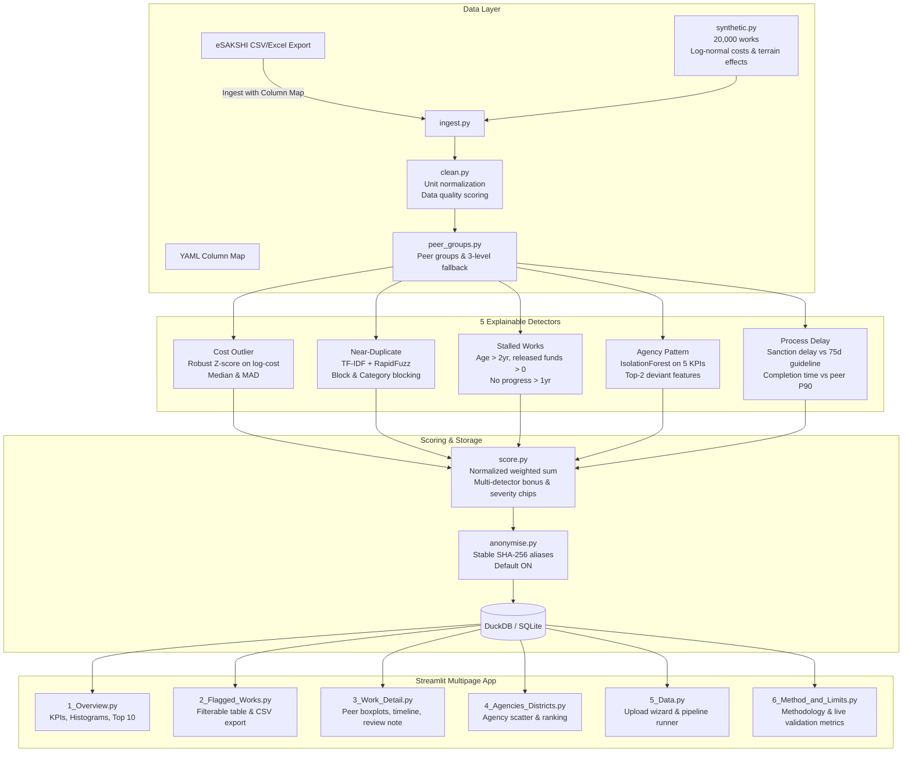

# MPLADS-Lens 🔍

**Smart India Hackathon (SIH26102) · Ministry of Statistics & Programme Implementation (MoSPI)**

An explainable, robust outlier detection and auditing decision-support system for MPLAD Scheme (Members of Parliament Local Area Development Scheme) works data.

---

> ⚠️ **IMPORTANT ETHICAL FRAMING: OUTLIER DETECTION FOR REVIEW, NOT FRAUD DETECTION**  
> MPLADS-Lens does not classify works, agencies, or individuals as "fraudulent", "corrupt", or "guilty". Public infrastructure projects face substantial legitimate cost variation due to difficult terrain (hill, desert, tribal, and coastal geographies), remote logistics, price escalation, natural disasters, or multi-phase scheduling. All flags generated by this system are statistical signals designed to triage works for human administrative review.

---

## 🏛️ System Architecture



---

## 🌟 Key Features

1. **Explainable Outlier Detectors:**
   - **Cost Outliers:** Evaluated against peer groups (`Category × District Class × Sanction Year`). If a peer group has fewer than 8 works, it falls back to `Category × State`, then `Category Only`.
   - **Near-Duplicates:** Flags suspiciously similar works in the same location sanctioned within a configurable window (e.g., 180 days) using TF-IDF cosine similarity and RapidFuzz `token_set_ratio`.
   - **Stalled Works:** Detects works sanctioned > 730 days ago with disbursed public funds and no progress updates for > 365 days.
   - **Agency Profiles:** Evaluates portfolio-level indicators using `IsolationForest` (completion rate, stall share, average delay, spend-to-release ratio, mean cost z-score).
   - **Process Delay:** Flags guideline violations (sanction delay > 75 days under April 2023 guidelines) and completion durations exceeding peer 90th percentile.

2. **Responsible Data Presentation:**
   - **Privacy By Default:** Anonymised view replaces real names with stable hashes (`Constituency C-017`, `Member M-042`, `Agency A-009`).
   - **Data-Source Transparency:** Header badge explicitly notes whether data is "Synthetic demo data" or "User-supplied data".
   - **Contextual Review:** Work detail pages include a "Legitimate reasons to check" checklist (terrain, revised scope, weather, data entry lags) and an in-app review log.

---

## 🚀 Quick Start

### 1. Requirements
- Python 3.11+
- Virtual environment recommended

### 2. Installation & Running
```bash
# Clone the repository and enter directory
cd mplads-lens

# Install dependencies
pip install -r requirements.txt

# Run the Streamlit application
streamlit run app.py
```

The application will automatically generate synthetic data and execute the pipeline on first launch.

---

## 📂 Using Real eSAKSHI MPLADS Data

To analyze real data downloaded from the [eSAKSHI Portal](https://esakshi.mospi.gov.in/):

1. Export works data in CSV or Excel format from the portal.
2. In MPLADS-Lens, navigate to the **📁 Data** page.
3. Upload your file. The built-in **Column Mapping Wizard** will auto-detect headers and map them to the canonical schema:
   - `work_id`, `work_title`, `work_category`, `sanctioned_amount`, `sanctioned_date`, `status`, etc.
4. Save the mapping YAML or click **Ingest & Run Pipeline**.
5. Once ingested, the data badge will reflect **User-supplied data** and your local records will be analyzed securely.

---

## ⚙️ Configuration Reference (`config/config.yaml`)

```yaml
detectors:
  cost:
    robust_z_threshold: 3.5      # Upward MAD robust z cutoff
    min_peer_group_size: 8       # Minimum peer sample size before fallback
  duplicate:
    cosine_threshold: 0.75       # TF-IDF cosine cutoff
    fuzzy_threshold: 80          # Token set ratio cutoff
    date_window_days: 180        # Date proximity window
  stalled:
    days_since_sanction: 730     # 2 years
    days_no_progress: 365        # 1 year without update
  agency:
    contamination: 0.08          # IsolationForest contamination rate
  delay:
    sanction_delay_threshold: 75 # Guideline threshold (days)
    completion_percentile_threshold: 90
scoring:
  weights:
    cost: 0.30
    duplicate: 0.25
    stalled: 0.25
    agency: 0.10
    delay: 0.10
  multi_detector_bonus: 5.0
```

---

## 🧪 Testing

Run the test suite with pytest:

```bash
pytest -v
```

All 5 detectors, synthetic generation, peer group fallbacks, anonymisation stability, and scoring bounds are covered.

---

## 🐳 Docker Deployment

To build and run via Docker:

```bash
docker build -t mplads-lens .
docker run -p 8501:8501 mplads-lens
```

Access the app at `http://localhost:8501`.
